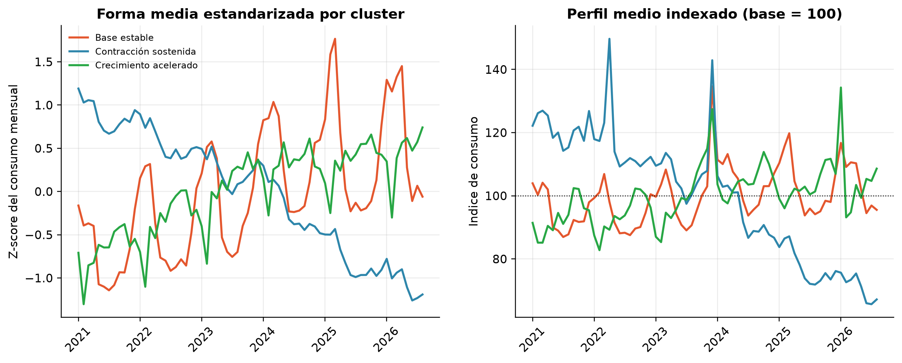
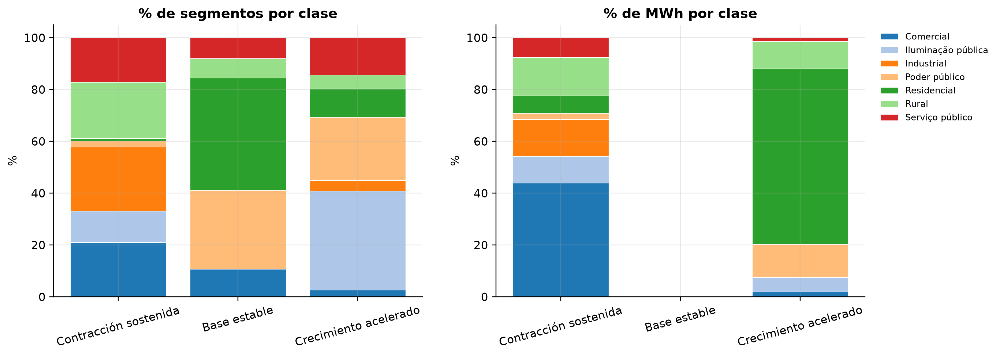
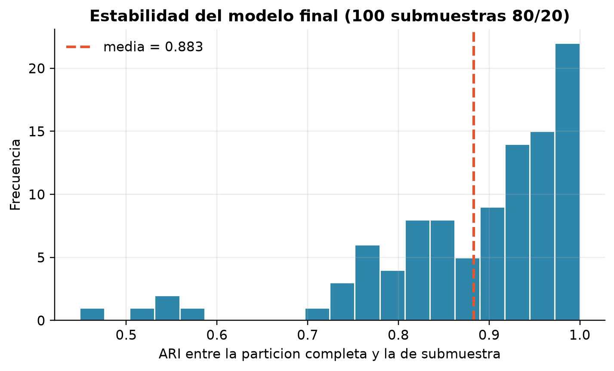
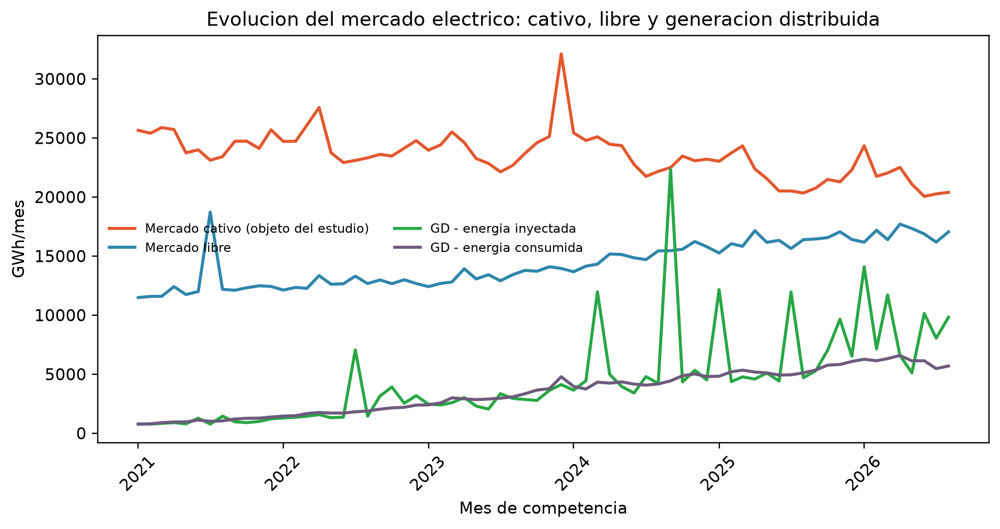
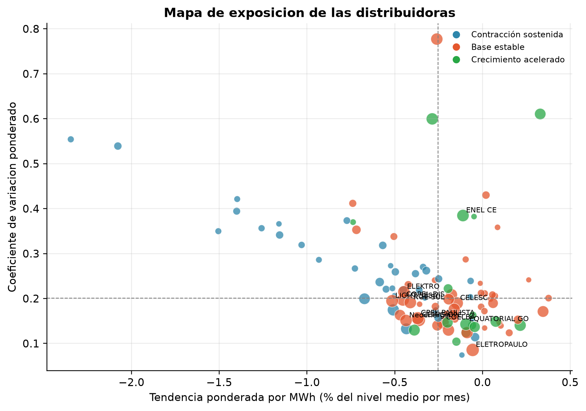

# Resultados

Todos los números de este documento provienen de los artefactos en
`reports/tables/` y son reproducibles con los comandos del `README.md`.

---

## 1. Del dato crudo al panel

| Etapa | Resultado |
|---|---:|
| Filas crudas (6 CSV) | 6.671.150 |
| Filas Regular + CATIVO | 2.116.425 |
| Filas `Energia TUSD (kWh)` | 302.717 |
| Celdas del panel | 55.140 |
| Unidades potenciales | 833 |
| Unidades con clases analizables | 734 |
| **Unidades incluidas** | **700** |
| Distribuidoras | 101 |
| Consumo incluido | 1.587,2 TWh |
| Cobertura del consumo filtrado | 99,4 % |

Las 34 unidades excluidas suman 10,2 TWh (0,6 %) y tienen cobertura < 95 %.

---

## 2. Diseño de experimentos

- **504 corridas** = 18 pipelines × 4 algoritmos × k = 2…8.
- Tiempo de ejecución: 3,1 min.
- Todas registradas en MLflow (`ANEEL_Clustering_DoE`).
- 68 candidatas tras filtros de interpretabilidad.

### 2.1 Top del ranking

| run_key | k | Silhouette (común) | Davies–Bouldin | Estabilidad | Balance | Score |
|---|---:|---:|---:|---:|---:|---:|
| `serie68\|winsor_z_fila\|kmeans\|k3` | 3 | 0,2553 | 1,876 | 0,928 | 0,402 | 0,902 |
| `serie68\|z_fila\|kmeans\|k3` | 3 | 0,2548 | 1,885 | 0,911 | 0,425 | 0,894 |
| `serie68\|log_z_fila\|kmeans\|k3` | 3 | 0,2519 | 1,910 | 0,935 | 0,423 | 0,889 |
| `pca2_serie\|none\|kmeans\|k3` | 3 | 0,2548 | 1,879 | 0,897 | 0,439 | 0,878 |
| `pca3_serie\|none\|kmeans\|k3` | 3 | 0,2548 | 1,882 | 0,900 | 0,442 | 0,868 |

**Lectura.** Las tres primeras posiciones son la misma representación
(`serie68`) con distintas normalizaciones. PCA queda cerca en silhouette pero
pierde estabilidad y no aporta interpretabilidad. Los algoritmos jerárquicos
rinden peor en estabilidad media (Ward 0,557; Average 0,672; Complete 0,521)
frente a KMeans (0,845).

### 2.2 El máximo de silhouette no es la respuesta

El máximo del grid es **0,312** con `k = 2` (`pca2_serie` o `serie68`). Se
descarta porque:

- con dos grupos no se distingue contracción de estabilidad/crecimiento;
- el balance es alto pero la interpretación es trivial (“alto vs bajo”);
- el score penaliza `k < 3` por diseño.

El caso más ilustrativo del espacio común es
`descriptores | robust_columna | average | k = 2`: silhouette **0,980** en su
espacio propio y **0,027** en el espacio de referencia. Si se hubiera rankeado
por la métrica propia, se habría elegido un artefacto de geometría. Esto se
explicita en la defensa: **no se eligió el número más alto, se eligió el mejor
compromiso documentado.**

---

## 3. Modelo final

`serie68 | winsor_z_fila | kmeans | k = 3`

| Métrica | Valor |
|---|---:|
| Silhouette (espacio propio) | 0,2635 |
| Silhouette (espacio común) | 0,2553 |
| Inercia | 26.027,4 |
| Estabilidad 100 submuestras | **0,883** (sd 0,113) |
| Estabilidad de semilla | 0,967 |
| Cramér's V vs clase | 0,568 (p = 2,9e-89) |
| Cramér's V tras quitar clase | 0,195 (p = 3,7e-07) |
| ARI original vs ajustado | 0,333 |

---

## 4. Arquetipos

| | Contracción sostenida | Base estable | Crecimiento acelerado |
|---|---:|---:|---:|
| Unidades | 366 | 187 | 147 |
| % de unidades | 52,3 % | 26,7 % | 21,0 % |
| Consumo total (TWh) | 629,8 | 710,0 | 247,3 |
| % del consumo | 39,7 % | 44,7 % | 15,6 % |
| CV medio | 0,329 | 0,190 | 0,213 |
| Tendencia (%/mes) | **−1,125** | +0,377 | +0,417 |
| Crecimiento 12 m | **−43,0 %** | +27,7 % | +38,4 % |
| Amplitud estacional | 0,347 | 0,375 | 0,336 |
| Fuerza estacionalidad | 0,178 | 0,445 | 0,311 |
| Autocorrelación anual | 0,615 | 0,685 | 0,504 |
| Consumidores (prom.) | 12,2 M | 58,4 M | 15,8 M |

### 4.1 Contracción sostenida (366 unidades, 39,7 % del consumo)

- Tendencia −1,12 %/mes y caída de 43 % en los últimos 12 meses.
- 100 % de las unidades del grupo tienen tendencia negativa.
- Mayor CV (0,329): la caída no es limpia, tiene ruido y estacionalidad.
- Composición: Industrial 91 (24,9 %), Rural 79 (21,6 %), Comercial 77 (21,0 %),
  Serviço público 63 (17,2 %), Iluminação pública 44 (12,0 %).
- Es el grupo más numeroso pero no el de mayor consumo: son segmentos
  pequeños/medianos, muchos de ellos en distribuidoras del Nordeste y del Sur.

### 4.2 Base estable (187 unidades, 44,7 % del consumo)

- Tendencia +0,38 %/mes, crecimiento +27,7 %, alta persistencia anual (0,685).
- Menor CV (0,190): comportamiento predecible.
- Composición: Residencial 81 (43,3 %), Poder público 57 (30,5 %),
  Comercial 20 (10,7 %).
- Concentra 58,4 M de consumidores: es el grueso de la base residencial.
- **No significa “sin riesgo”**: varias distribuidoras grandes tienen este grupo
  como dominante y aun así tendencia ponderada negativa (ver §6).

### 4.3 Crecimiento acelerado (147 unidades, 15,6 % del consumo)

- Tendencia +0,42 %/mes, crecimiento +38,4 %, pero alta volatilidad (yoy_std 0,495).
- Composición: Iluminação pública 56 (38,1 %), Poder público 36 (24,5 %),
  Serviço público 21 (14,3 %).
- Dominado por EQUATORIAL GO (17,8 %), ENEL CE (15,5 %) y EQUATORIAL PA (12,7 %).
- Crecimiento concentrado en consumo público, no en industria ni residencia.

### 4.4 Composición por clase

| Clase | Contracción | Base estable | Crecimiento |
|---|---:|---:|---:|
| Comercial | 77 | 20 | 4 |
| Iluminação pública | 44 | 0 | 56 |
| Industrial | 91 | 0 | 6 |
| Poder público | 8 | 57 | 36 |
| Residencial | 4 | 81 | 16 |
| Rural | 79 | 14 | 8 |
| Serviço público | 63 | 15 | 21 |

Industrial, Rural y Comercial se concentran en contracción; Residencial y Poder
público en base estable; Iluminación pública en crecimiento. La asociación es
fuerte (V = 0,568) pero no perfecta: hay 4 unidades residenciales en contracción y
6 industriales en crecimiento.

---

## 5. Validación estadística

### 5.1 Descriptores

| Descriptor | H | p | ε² | q FDR |
|---|---:|---:|---:|---:|
| `tendencia_pct_mes` | 504,8 | 2,4e-110 | **0,721** | 4,6e-109 |
| `crecimiento_12m` | 499,3 | 3,8e-109 | **0,714** | 3,6e-108 |
| `yoy_media` | 434,6 | 4,2e-95 | 0,621 | 2,6e-94 |
| `drawdown_max` | 202,3 | 1,2e-44 | 0,287 | 5,5e-44 |
| `fuerza_estacionalidad` | 175,4 | 8,0e-39 | 0,249 | 3,0e-38 |
| `ac1` | 147,6 | 9,0e-33 | 0,209 | 2,8e-32 |
| `tendencia_r2` | 125,2 | 6,4e-28 | 0,177 | 1,7e-27 |
| `valle_cos` | 119,7 | 1,0e-26 | 0,169 | 2,5e-26 |

Los 19 descriptores sobreviven a FDR. La separación es de **trayectoria**, no de
estacionalidad ni de ruido.

### 5.2 ¿Solo clase?

- Cramér's V = 0,568 → asociación fuerte.
- Tras restar el centroide de cada clase y re-clusterizar: V = 0,195 y ARI = 0,333.
- Conclusión: la clase explica una parte relevante, pero el arquetipo conserva
  estructura propia. Se reporta como limitación.

### 5.3 Estabilidad

ARI medio 0,883 con 100 submuestras. La distribución no tiene colas catastróficas:
incluso los peores submuestreos mantienen una estructura reconocible.

### 5.4 Verificación independiente en Orange

El modelo final se exportó a `reports/orange/aneel_orange_serie68_z.csv`
(serie winsorizada y estandarizada por fila) y se reconstruyó en Orange 3.41
sobre un entorno Python separado. La réplica reproduce la partición del
proyecto:

| Comprobación | Resultado |
|---|---:|
| ARI vs. proyecto | **1,0** |
| Coincidencia tras mapeo de etiquetas | 1,0 |
| Silhouette | 0,2635 (= proyecto) |
| Tamaños | 366 / 187 / 147 |

Como control negativo, la misma rutina con los 19 descriptores produce
ARI = 0,036 y tamaños 509 / 185 / 6. Ese clúster de 6 unidades es coherente con
que la representación por descriptores quedó fuera del DoE por tamaño mínimo y
balance. La réplica exacta usa el mismo KMeans de scikit-learn que el pipeline:
**valida la exportación y la configuración, no un algoritmo distinto**, y así se
declara. Detalle en `docs/08_guia_orange.md` y
`reports/tables/orange_verificacion.json`.

---

## 6. Contexto de mercado

| Serie | 2021 (GWh/mes) | Últimos 12 m (GWh/mes) | Variación |
|---|---:|---:|---:|
| **Regular CATIVO** | 24.677 | 21.521 | **−12,8 %** |
| Regular LIVRE | 12.588 | 16.779 | +33,3 % |
| GD energía inyectada | 972 | 8.429 | +767,3 % |
| GD energía consumida | 1.057 | 5.980 | +465,6 % |
| Regular SUPRIMENTO | 340 | 218 | −35,9 % |
| Regular DISTRIBUIÇÃO | 413 | 480 | +16,3 % |

La caída del cativo no es un artefacto: coincide con el crecimiento del libre y de
la GD. El mercado cativo pierde participación frente a alternativas de
autogeneración y contratos libres.

**Límite interpretativo.** El panel mide consumo facturado en el cativo. Un
segmento que migra al libre “cae” en el cativo aunque siga consumiendo. Por eso se
habla de **exposición del cativo**, no de caída del consumo físico.

---

## 7. Exposición por distribuidora

| Cluster dominante | Distribuidoras |
|---|---:|
| Base estable | 49 |
| Contracción sostenida | 36 |
| Crecimiento acelerado | 16 |

- 36 distribuidoras tienen la contracción como grupo dominante.
- 33 están en el cuadrante “contracción-volátil” y 17 en “contracción-estable”.
- Las mayores distribuidoras (ELETROPAULO, CEMIG-D, CPFL-PAULISTA, COPEL-DIS,
  COELBA) tienen base estable como dominante, pero entre 30 % y 48 % de su consumo
  está en el grupo de contracción.

| Distribuidora | Consumo (TWh) | % en contracción | Tendencia ponderada | Cluster dominante |
|---|---:|---:|---:|---|
| ELETROPAULO | 156,0 | 34,1 % | −0,06 %/mes | Base estable |
| CEMIG-D | 123,0 | 42,1 % | −0,36 % | Base estable |
| CPFL-PAULISTA | 103,4 | 39,5 % | −0,37 % | Base estable |
| COPEL-DIS | 98,8 | 48,2 % | −0,45 % | Base estable |
| COELBA | 87,5 | 29,8 % | −0,23 % | Base estable |

**Matiz honesto.** Que una distribuidora tenga clúster dominante “base estable” no
implica que su consumo esté creciendo: la tendencia ponderada puede ser negativa
porque pocos segmentos grandes caen. Por eso se reportan **dos vistas**:

- **conteo de unidades** → qué tan extendido está el fenómeno;
- **consumo ponderado** → cuánto pesa económicamente.

Una lectura solo por conteo subestima el riesgo; una lectura solo por consumo
oculta que la contracción afecta a la mayoría de los segmentos.

---

## 8. Figuras

| Archivo | Contenido |
|---|---|
| `01_cobertura_temporal.png` | consumo mensual y mes parcial excluido |
| `02_unidades.png` | distribución de tamaño por unidad |
| `03_doe_calidad_estabilidad.png` | 504 corridas: silhouette vs estabilidad |
| `04_doe_heatmap.png` | efecto de representación × escalado |
| `05_curva_k.png` | codo de inercia y silhouette por k |
| `06_silueta.png` | silhouette por unidad y arquetipo |
| `07_pca_scatter.png` | **PC1 vs PC2** (corrección del scatter anterior) |
| `08_centroides.png` | centroides normalizados de los 3 arquetipos |
| `09_descriptores.png` | distribuciones de descriptores por arquetipo |
| `10_composicion_clases.png` | composición por clase |
| `11_exposicion_distribuidoras.png` | riesgo por distribuidora |
| `12_estabilidad.png` | distribución de ARI en 100 submuestras |
| `13_mercado_cativo_livre_gd.png` | cativo vs libre vs GD |

---

## 9. Qué haría cambiar la conclusión

| Cambio | Efecto esperado |
|---|---|
| Incluir el mercado libre en la misma matriz | mezclaría universos; el arquetipo de contracción se diluiría |
| Usar `VlrMercado` sin separar unidades | resultado inválido (error del trabajo anterior) |
| Elegir k por silhouette puro | k = 2, sin valor decisional |
| No normalizar por fila | clústeres por tamaño, no por comportamiento |
| Ventana más corta (2025-2026) | menos potencia para distinguir tendencia de ruido |
| Validación temporal hacia adelante | mediría persistencia real de etiquetas; pendiente |

---

## 10. Conclusión

1. El cativo se puede segmentar en tres arquetipos estables y accionables.
2. La mayoría de los segmentos está en contracción sostenida.
3. La contracción coincide con migración al libre y GD.
4. El resultado es robusto (0,883), significativo (FDR) y no es solo la clase.
5. La decisión se puede localizar por distribuidora y por clase.
6. Los límites están declarados y acotan la interpretación.
